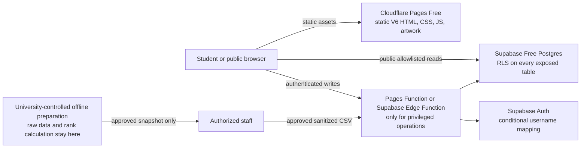

# Academic Arena V1: free-tier architecture recommendation

- **Status:** M0 recommendation, pending the identity approval gate.
- **Reviewed:** 15 November 2026
- **Scope:** Architecture only. No production service or real university data is configured.

## Goals and constraints

- Keep the approved V6 vanilla HTML, CSS, JavaScript, and artwork. Preserve the podium and crown, EUE identification, both character families, level/semester/module filters, Campus Wins, and responsive layouts.
- Keep delivery within GitHub Free, Cloudflare Pages Free, and Supabase Free. Treat quotas, free-plan behavior, and provider terms as subject to change; verify again before account setup.
- Keep the public site read-only. Only publish university-approved names and ranks, and only after director, privacy, and IT approval. Never publish grades, scores, attendance, student IDs, credentials, emails, internal IDs, or private account-to-student mappings.
- Process raw academic records and calculate rankings inside an authorized university environment. Upload only an allowlisted, publication-approved snapshot.
- Do not depend on the current long-running FastAPI/SQLite deployment. Retain its useful domain validation and test behavior as a reference while moving hosting responsibilities to static Pages and the smallest necessary serverless functions.
- Keep development and staging fictional. Production mode must fail closed and must never fall back to fictional demo rows.

## Current V6 shape

V6 is a small static frontend: `index.html`, `assets/app.css`, `assets/app.js`, `assets/server-adapter.js`, and local artwork. It includes six desktop/mobile reference screenshots. Its optional local pilot uses FastAPI, SQLAlchemy, SQLite, Argon2id, an opaque cookie session, an offline staff CLI, and one smoke test. The README explicitly says the server setup is local-only and not security-audited.

The visual screenshots retain the approved direction. The EUE wordmark is explicitly a draft pending an approved logo asset. The demo contains fictional names and sample rankings according to the supplied README and CSV; these remain staging-only.

## Recommended deployment shape

### Public reads

Serve the V6 files as static assets. Read only approved public fields from a published snapshot: academic year, level, semester, approved cohort/module, rank, approved public name, approved avatar preset/family, approved achievement template, and reaction totals. Public responses must not include private join keys or author/reaction account IDs. Apply RLS to every exposed Postgres table and grant only the exact operations needed.

If the database is unavailable, show a clearly dated, approved static ranking snapshot only when the university has approved that exact copy. Disable sign-in, posting, and reactions while offline. Provide a documented urgent snapshot removal and CDN cache purge path. Without an approved snapshot, show a service-unavailable state. Never silently show the fictional demo on a live hostname.

### Student identity and writes

The student login interface remains username and password, with no public sign-up. Supabase identity is conditional on approval to use existing, legitimate university-issued email addresses as private provider identifiers. If approved, a same-origin server function resolves the username privately, calls Supabase Auth, and manages the session in secure HttpOnly cookies. The mapping is unavailable to anonymous and student database clients. Staff reset credentials through an approved staff process; no SMS or email delivery dependency is introduced.

Students may update only their own avatar preferences and submit eligible approved Campus Wins templates. They cannot write public names, ranks, cohort/module membership, roles, account links, or moderation state. Use server-verified identity plus restrictive RLS, not frontend field hiding.

This design is not approved for implementation yet. See `docs/auth/username-password-feasibility.md`.

### Staff operations and publishing

Keep raw academic files offline. Staff uploads only allowlisted sanitized CSV through a privileged route. Validate all rows and the complete set of expected boards, build a versioned candidate, preview a diff, and publish in one transaction. A publication retires boards omitted from the new snapshot. Keep rollback and urgent unpublish/takedown operations. Store publisher, reviewer, timestamps, version, and reason in an audit trail. Never log credentials or upload files.

Campus Wins V1 uses fixed, staff-approved templates and approved icons/backgrounds. It has no free text, comments, images, links, tags, or direct messages. Enforce one pending item and one submission per week per account on the server. Staff may approve, reject, hide, or remove. Reactions are limited to heart, clap, and fire; enforce one active reaction per account/post atomically and return counts only.

## Free-tier fit and operating limits

The provider pages currently document:

| Service | Current free allowance or behavior | Practical consequence |
| --- | --- | --- |
| GitHub Free | Unlimited private repositories and 2,000 standard-runner minutes/month | Private runner usage draws from included compute and can bill after the allowance if billing is enabled. Keep Actions disabled until additional spending is blocked. Use a university-controlled owner/custodian account before launch. The current repository is private but still owned by a personal GitHub account. |
| Cloudflare Pages Free | 500 builds/month, up to 20,000 files/site, 25 MiB per file | The V6 static site fits the intended model; check the actual asset bundle before configuring Pages. |
| Cloudflare Workers / Pages Functions Free | 100,000 requests/day shared across Workers and Pages Functions; 10 ms CPU per invocation | Keep functions small and avoid CPU-heavy password hashing in a Worker without a measured compatibility/performance proof. |
| Cloudflare D1 Free | 5 million rows read/day, 100,000 rows written/day, 5 GB total storage | A possible auth alternative, but it does not by itself solve the audited username-only authentication requirement. |
| Supabase Free | 50,000 MAU, 500 MB database, 5 GB egress; free projects pause after one week inactive | Dynamic features may be offline during breaks. Staff need a restore/runbook and a visible static or unavailable fallback. |
| Supabase Free backups | No daily automatic backups listed for Free; daily backups are a paid-plan feature | Require encrypted offsite exports, publication pre-backups, weekly active-term cadence, and a tested restore drill. |

Do not add a credit-card-dependent service, metered paid fallback, paid DNS/domain, SMS, Redis, or persistent compute. Configure provider alerts and spending controls where available, and fail closed when quotas are exhausted. Zero-cost hosting does not promise continuous availability.

### Provider references

- [GitHub plans and pricing](https://github.com/pricing)
- [Cloudflare Pages limits](https://developers.cloudflare.com/pages/platform/limits/)
- [Cloudflare Workers pricing and free limits](https://developers.cloudflare.com/workers/platform/pricing/)
- [Cloudflare D1 pricing](https://developers.cloudflare.com/d1/platform/pricing/)
- [Supabase pricing](https://supabase.com/pricing)
- [Supabase free-project pausing](https://supabase.com/docs/guides/platform/free-project-pausing)
- [Supabase database backups](https://supabase.com/docs/guides/platform/backups)
- [GitHub Terms of Service](https://docs.github.com/en/site-policy/github-terms/github-terms-of-service)
- [GitHub Actions billing and budgets](https://docs.github.com/en/billing/concepts/product-billing/github-actions)
- [Cloudflare Self-Serve Subscription Agreement](https://www.cloudflare.com/terms/)
- [Supabase Terms of Service](https://supabase.com/terms)
- [Supabase Data Processing Addendum](https://supabase.com/legal/customer-resources/data-processing-addendum)

Provider limits were checked on 15 November 2026. Recheck at project creation and before each release. This review did not create a provider account or validate a production plan, data-processing agreement, or institutional procurement approval.

## Terms and institutional account checks

- GitHub Free permits private repositories. Its Terms treat private repository content as confidential subject to stated service, security, and legal exceptions. Private Actions use can incur charges after included compute if billing is enabled; keep CI disabled until the billing account has a zero-spend limit or no payment method. The present repo is owned by a personal account, so the university still needs to approve the custodian or move it to an institution-controlled owner.
- Cloudflare's self-serve agreement permits free services but describes them as free services that may be changed or terminated, and prohibits bypassing product usage limits. This design uses no artificial keepalive traffic or quota circumvention. Free hosting provides no institutional uptime commitment.
- Supabase's terms make the customer responsible for rights, consent, and instructions for submitted customer data. A DPA is available, but EUE must determine whether its terms, processing region, and data handling are acceptable before any student identity or record is sent there.

This is a technical fit review, not legal advice or approval to process university data. Institutional IT, privacy, procurement, and the director must review and approve the actual provider accounts and agreements before production use.

## Milestone boundary

M0 establishes findings and decisions. M1 may adapt only the static V6 frontend and fictional preview after the identity decision is approved. M2 remains blocked until the identity proof, staff MFA enforcement, migrations, and RLS are accepted. M3 and M4 remain separate reviewable milestones. No public deployment or real ranking import is authorized by this document.
