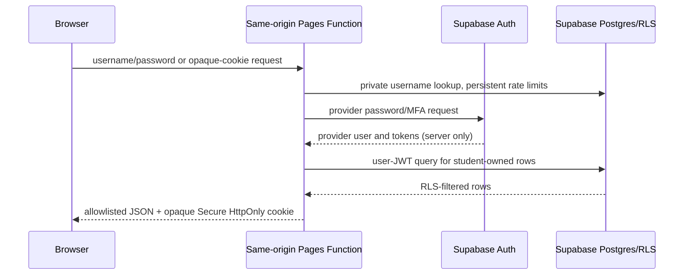

# Milestone 2 authentication and database foundation

- **Status:** Database/RLS slice implemented and locally verified; BFF/session lifecycle remains in progress on `m2/auth-database-foundation`.
- **Authorization:** Fictional local identities only. No hosted Supabase project, real EUE identities, public ranking data, or public deployment is authorized.
- **Architecture:** Cloudflare Pages Functions BFF, Supabase Auth/Postgres Free, GitHub Free CI.

## Goals and non-goals

M2 implements the server trust boundary that the M1 frontend already calls. Students authenticate with a staff-issued username/password. Supabase Auth remains the password verifier, while the BFF privately resolves usernames to provider identifiers and keeps provider tokens out of browser responses. RLS and server authorization protect every database operation.

M2 prepares, but does not implement, leaderboard import/publication or Campus Wins moderation/reactions. It does not create a hosted provider project, import real identity mappings, publish student names, or deploy Pages publicly. Raw academic records remain outside the application.

## Approaches considered

1. **Same-origin BFF with Supabase Auth and user-JWT database calls — selected.** The BFF owns login, sessions, account administration, rate limits, and staff authorization. Normal student-owned database reads/writes use the authenticated user's Supabase JWT so PostgreSQL RLS remains an independent enforcement layer. A server-only key is limited to private session/mapping operations and privileged account tasks.
2. **BFF with service-role access for all database work — rejected.** The service role bypasses RLS, making every ownership and role decision depend on application code.
3. **Direct browser-to-Supabase Auth — rejected.** Supabase Auth responses and access-token claims contain the provider email and tokens that must remain private.

## Request and identity boundary

The browser calls only `/api/*` on its own origin. The BFF never returns an Auth user object, provider email, provider access/refresh token, role grant table, private mapping, or service credential. Session JSON contains only authentication state, a safe role enum, and required password/MFA steps. Responses containing authentication or account data are `Cache-Control: no-store`.

The username-to-email table is in a non-exposed private schema. `authenticated` receives schema usage only for RLS helper calls; it receives no private-table privileges, and the schema is absent from PostgREST's exposed schema list. `public.provision_account` and `public.consume_login_rate_limit` are the only server RPCs in this first migration; execution is revoked from `PUBLIC`, `anon`, and `authenticated` and granted only to `service_role`. Account provisioning verifies that the provider user exists and that its email matches the private mapping, creates only the `student` role, and records a credential-free audit event. There is no username availability endpoint. The rate-limit RPC accepts only 32-byte caller-generated keyed hashes, increments username and client-IP buckets atomically, allows at most 8 attempts per username and 40 per IP per fixed 15-minute bucket, and returns only allow/deny. The BFF must use a server secret for those HMAC keys and a generic status/body for unknown, incorrect, suspended, and limited logins. Request bodies, passwords, cookies, MFA codes, and provider responses are excluded from logs.

## Session design

- The browser holds only a 256-bit random opaque session value in a `__Host-` cookie with `Secure`, `HttpOnly`, `SameSite=Strict`, `Path=/`, and no `Domain` attribute.
- Postgres stores a SHA-256 hash of that random value, account/session metadata, CSRF-token hash, expiry/revocation state, and a JWE-encrypted provider access token. The encryption key is a Cloudflare secret; local development uses ignored `.dev.vars` values.
- The provider refresh token is not returned to the browser. Student refresh tokens are revoked after login and discarded. The BFF session expires no later than the provider access token, with a shorter idle timeout and absolute lifetime. Staff pre-MFA sessions retain provider tokens encrypted only for the short MFA setup/step-up window; successful AAL2 verification revokes the provider refresh token and removes it from the BFF session.
- Logout, password change/reset, suspension, expiry, or administrator revocation marks BFF sessions revoked in Postgres. Every BFF request checks session and account state. Database RLS also checks current account status so stale provider JWTs cannot access student-owned tables after suspension.
- Mutating requests require exact same-origin validation and a CSRF token bound to the server-side session. Login is also origin-checked. Redirects are rejected for credential-bearing requests.

Session encryption and opaque-cookie generation use maintained JOSE and platform cryptography APIs; no password hashing, JWT, encryption, or TOTP primitive is implemented in application code. The local provider test must confirm sign-out revokes refresh tokens while existing access tokens remain usable only until expiry.

## Account lifecycle and staff MFA

Public registration is disabled. Student accounts are created through an AAL2-authorized staff BFF route. Creation assigns a private provider identity mapping, an initial credential, a forced password-change flag, and an audit event. The route never accepts a client-selected role. Student recovery is staff-mediated; the reset path issues a one-time credential, requires a password change, revokes BFF sessions, and records a credential-free audit event. No SMS or email service is used.

Supabase TOTP is the staff second factor. A staff login remains in a short-lived, restricted pre-authentication state until a factor is enrolled and verified or an existing factor has been challenged and verified. No privileged route is available from AAL1. The database `has_permission` helper combines current active account/role state with the signed JWT `aal2` claim. The private staff tables are not exposed to PostgREST; any future authenticated-user staff RPC/policy must call this helper. Service-role Auth Admin operations cannot be protected by PostgreSQL RLS, so the BFF must independently re-check the current staff role and AAL2 before invoking them and audit the action. The local provider E2E suite must exercise actual TOTP enrollment, challenge, verification, and attempted AAL1 bypass.

Initial administrator assignment is an explicit server-side bootstrap operation, not public registration or a student-editable field. Role grants are private and every staff-account change is audited.

## Database boundaries

- `supabase/migrations/202611160001_m2_identity_and_public_schema.sql` creates `app_private.accounts`, `identity_mappings`, `account_role_grants`, `role_permissions`, `bff_sessions`, `login_rate_limit_buckets`, `audit_events`, `campus_wins_submissions`, and `campus_wins_reactions`. All private tables have RLS enabled and forced, with no browser table privileges or policies.
- `public.student_avatar_configs` uses forced RLS tied to the active account derived from `auth.uid()`. Column-level grants omit the private `account_id`; inserts assign ownership in a trigger, and students cannot delete rows or write identity/role fields.
- The public ranking schema models one versioned current snapshot at a time. A partial unique index prevents multiple current versions; rows preserve level 4/5/6, semester 1/2, cohort, semester/module board kind, optional module key, position, public name, and approved avatar fields. Constraints reject invalid level/semester/module combinations. RLS lets anon/authenticated read only the active, non-revoked snapshot and rows. The projection contains no account/student IDs, grades, scores, or attendance.
- `public.campus_wins_public` contains only the post key, approved fixed template, public author/display fields, publication timestamp, and three aggregate reaction counts. A server-owned trigger checks that every public row matches an approved private submission snapshot. Private status, ownership, moderation records, and reaction identities remain in `app_private`; a unique private reaction key enforces one active reaction per account/post.
- Security-definer helpers pin `search_path` to empty, qualify relations, derive identity from `auth.uid()`, and use database roles rather than client-supplied role claims. RLS helper functions have explicit execute grants. The only RPCs exposed in this migration are service-role-only account provisioning and rate-limit consumption.

Competition keys preserve the existing structure: level 4/5/6, semester 1/2, cohort, board kind (`semester` or `module`), and a module key only for module boards. Publication and Campus Wins workflows remain M3 responsibilities.

## Local verification and free-tier limits

The committed Supabase CLI configuration uses pinned CLI `2.121.0` and its experimental native stack runtime for local Auth, Postgres, and PostgREST. The native runtime is supported on macOS 14+ Apple silicon and Ubuntu 24.04; its dynamically assigned API and database ports are checked against live OS listeners and must bind only to `127.0.0.1` or `::1`. The local project is not linked to a hosted project.

The Auth configuration keeps the email/password provider enabled for existing staff-provisioned accounts while disabling project-wide sign-up. The local Auth endpoint test confirms a public signup request is rejected. Provider-backed tests create random `*.academic-arena.test` accounts with `email_confirm=true`, because Supabase Auth requires a confirmed email state before password sign-in in this local configuration. That local provider flag is a test prerequisite only; it does not verify a mailbox, establish a real-world identity, or authorize an institutional address. Test accounts and random credentials are deleted after each run and are never stored in `seed.sql`. No real email or account is used.

The native stack uses an experimental Supabase CLI feature, pinned in `package.json`. This affects only local test infrastructure, not the approved Cloudflare Pages + Supabase Free production architecture. The runner suppresses CLI key output and passes local keys only to the test process.

CI starts this local stack, applies reviewed migrations, and creates/deletes fictional users dynamically. `npm run test:m2:local` now runs 51 pgTAP/RLS assertions and live HTTP Auth/PostgREST tests against the local Supabase stack. These verify schema/table grants, current snapshot filtering, no accidental private columns, board constraints, approved Campus Wins projection consistency, disabled public signup, local account provisioning, student avatar isolation, hidden owner IDs, and service-only account provisioning. Session/BFF lifecycle, login-rate concurrency, password changes, suspension revocation, CSRF/origin, staff TOTP/AAL2 provider flows, and multi-request session behavior remain pending implementation and tests; local Auth itself has been exercised, but those lifecycle controls are not yet verified.

No Redis, SMS, paid compute, external email, or hosted credentials are introduced. The project remains subject to Cloudflare/Supabase Free quotas and Supabase pause behavior. M2 does not claim continuous availability or production provider verification.

## External integration gates

Before any real identity is provisioned, appropriate university personnel must approve the source roster, external processing of legitimate institutional emails in Supabase, processing region/terms, staff custodians, recovery procedures, notices/retention, and account ownership. The M2 test suite uses only local fictional identities. A hosted Supabase project and provider credentials will not be created or used without separate authorization.
