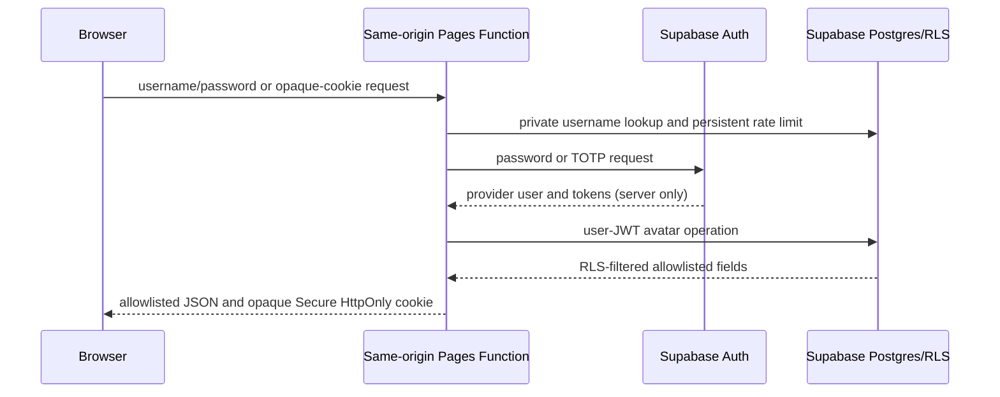

# Milestone 2 authentication and database foundation

- **Status:** Implemented candidate on `m2/auth-database-foundation`; local Auth, session, MFA, account lifecycle, avatar ownership, and RLS tests pass. Independent review and hosted-project validation remain outstanding.
- **Data boundary:** Fictional local identities only. No hosted Supabase project, real EUE identities, academic records, or public deployment is authorized.
- **Architecture:** Cloudflare Pages Functions BFF, Supabase Auth/Postgres Free, GitHub Free CI. No paid infrastructure or external email/SMS delivery is used.

## Goals and non-goals

M2 supplies the same-origin server trust boundary behind the M1 frontend. Students authenticate with a staff-provisioned username and password. Supabase Auth verifies the password; a private database mapping resolves the username to the provider email only inside the BFF. The browser receives an opaque session cookie and a small allowlisted summary. Student-owned avatar reads use the user's Supabase JWT and RLS. Avatar writes call a narrow authenticated database function that derives the owner from `auth.uid()` and performs one atomic upsert; browser roles have no direct table-write grant.

The local implementation exercises account provisioning, initial password changes, staff-mediated recovery and suspension, staff TOTP MFA, private server-side sessions, persistent login/MFA rate limits, audit records, and avatar ownership. The account provisioning, recovery, suspension, and staff-MFA-reset routes deliberately return an authorization-required response outside `ENVIRONMENT=test`; they cannot create or modify hosted identities until a later, explicitly authorized integration step.

M2 creates structures for future leaderboard snapshots and Campus Wins public projections. It does not implement CSV import/publication, ranking decisions, Campus Wins moderation/reactions, or static snapshots. Raw academic records remain outside the application. No production records or names are seeded.

## Decisions

1. **Same-origin BFF with Supabase Auth and user-JWT database calls — selected.** The BFF owns username resolution, login, cookie sessions, account lifecycle, rate limits, and staff authorization. Student-owned operations use a request-scoped client with the authenticated user's provider JWT, not the service role.
2. **Service-role access for every database operation — rejected.** It bypasses RLS and would make every ownership decision depend only on application code. The service role is used only for private session/mapping/rate-limit functions and Auth Admin operations after a second server-side authorization check.
3. **Direct browser-to-Supabase Auth — rejected.** Supabase Auth responses include the user email, and access tokens include email claims. Resolving the username on the server does not hide the email once the browser receives the Auth response or JWT.
4. **Fabricated verified emails — rejected.** Local fixtures use reserved `*.academic-arena.test` addresses and a local provider confirmation flag only to exercise Supabase password login. This is not mailbox verification and is never used for an institutional identity.

## Request and identity boundary

The browser calls the same origin only. Implemented routes are:

- `POST /api/auth/login`, `GET /api/auth/session`, `POST /api/auth/logout`, and `POST /api/auth/change-password`.
- `POST /api/auth/mfa/enroll` and `POST /api/auth/mfa/verify` for staff TOTP setup and step-up.
- `GET /api/me/avatar` and `PUT /api/me/avatar` for the signed-in account's character configuration.
- `POST /api/staff/accounts`, `/api/staff/accounts/recovery`, `/api/staff/accounts/suspend`, and `/api/staff/accounts/mfa-reset` for local fictional staff lifecycle testing.

The BFF never returns a Supabase user object, email, provider access or refresh token, service-role credential, private identity mapping, database account ID, or role grant table. Avatar requests accept only character, family, tone, and badge allowlists; they never accept an owner ID. Login and MFA return only role and required-action flags. TOTP enrollment returns only the one-time secret required for manual authenticator setup; the provider URI is deliberately omitted because its label may contain the provider email. Every API response is `private, no-store`, varies on Cookie, and uses restrictive response headers.

The username/email mapping is in the non-exposed `app_private` schema. `anon` and `authenticated` have no mapping table privileges. There is no username availability endpoint. Login normalizes the username, applies an atomic persistent 15-minute limit (8 attempts per username and 40 per edge IP), and returns the same 401 body and minimum-duration response for unknown, incorrect, suspended, and throttled accounts. Rate-limit keys are HMACed in the BFF; only keyed hashes are stored. Login, password change, and MFA verification share those persistent buckets.

## Session and CSRF design

- The browser holds a random 256-bit `__Host-aa_session` cookie with `Secure`, `HttpOnly`, `SameSite=Strict`, `Path=/`, and no `Domain`. The cookie contains no provider token or user identifier.
- Postgres stores only a SHA-256 hash of the opaque cookie. It stores provider access, refresh, and CSRF material as compact JWE encrypted with a 256-bit server key. The BFF decrypts values in request memory. Cookie revocation clears the encrypted values from the session row.
- `SESSION_JWE_KEY` and `RATE_LIMIT_HMAC_KEY` are Cloudflare server secret bindings, never Wrangler vars or frontend build inputs. The local runner creates ephemeral 256-bit values in ignored mode-0600 `.dev.vars` and restores/removes that file when the Pages preview ends.
- The session idle limit is 30 minutes and the absolute limit is 8 hours, but session expiry is always earlier than the provider JWT expiry. With the local/default one-hour access token and no automatic refresh loop, an ordinary session currently lasts at most that JWT lifetime. The user must sign in again after expiry. Staff MFA step-up replaces the server-encrypted token pair in the same BFF session.
- Every BFF request hashes the cookie, resolves the session and active account server-side, and validates the access token with Supabase Auth `getUser`. The BFF reads claims only after provider validation. Staff sessions also recheck provider TOTP factors and treat the request as AAL1 unless an active verified TOTP factor exists and the provider JWT carries `aal2`.
- Logout, password change, staff recovery, suspension, MFA recovery, idle timeout, expiry, and administrator action revoke the server-side BFF row and clear its encrypted token material. Logout also attempts provider sign-out for that provider session. Student suspension bans provider sign-in; password recovery changes the provider password; staff MFA recovery deletes provider factors. These provider-side actions are distinct from revoking every prior provider refresh token. Local tests confirmed that an already issued access JWT may remain accepted directly by PostgREST until `exp`; the browser never receives that token and every application API request must first pass the immediately revocable BFF session check. RLS also checks active account state and forced-password state. Hosted provider invalidation semantics remain unverified.
- Login and every mutation require exact same-origin validation. Mutations also require a session-bound CSRF token compared by constant-time hash. Upstream requests reject redirects. API exceptions return generic unavailable responses and do not log credentials, bodies, codes, cookies, or provider responses.

Opaque cookies and JWE use maintained `jose` plus platform WebCrypto. Password verification, JWT issuance, and TOTP generation/verification remain in Supabase Auth. Application code does not implement cryptographic primitives.

## Account lifecycle and staff MFA

Public registration is disabled. Student provisioning is exercised only in the loopback local environment: an AAL2-authorized admin creates a provider user with a random temporary credential, maps the fictional username privately, assigns only the `student` role, and receives that credential once. The browser cannot choose a role. The account is barred from protected data until it changes the temporary password. Password changes require the current password, a 15–128 character new password, and revoke all existing BFF sessions.

Student recovery creates a temporary credential, encrypts it with the server-only session key, and stores it in a private retry record with a 15-minute window. The BFF sets the forced-change and private `credential_update_pending` flags, revokes sessions, then updates the provider password. Login, session resolution, account data access, and password completion are blocked while provider synchronization is pending. Before a provider-side recovery or staff MFA reset, the BFF atomically claims the operation; only a hash of its random token is stored. Supabase Auth does not accept a fencing token, so a claim is deliberately **non-expiring**: only an explicit provider HTTP response or a completed provider mutation can release it, and only the matching claim can finalize. The provider fetch has a 15-second timeout. For the password update, the claim is released only when Auth answers with one of its documented pre-write error codes (`passwordUpdateRejectedBeforeWrite`); any other outcome (no response, timeout, 5xx, unrecognised 4xx) leaves it held indefinitely, because elapsed time is not evidence that the request can no longer apply. Retries then cannot create a new credential epoch or send a second provider request. The database owner reconciles explicitly with `app_private.operator_release_stuck_credential_sync`, which destroys the never-revealed temporary password; staff then run a fresh recovery. If that old write lands later, it can only leave a password nobody was shown (lockout, no disclosure), fixed by an ordinary recovery; this is tested with a delayed local provider write. After a pre-write rejection, a retry in the same epoch reuses the same encrypted password. Staff MFA reset releases after any failure: listing factors is a read and each delete names one existing factor ID, so a retry re-lists and deletes what remains. Only after Auth Admin succeeds does a server-only RPC clear the pending flag and erase the encrypted temporary password for that epoch. Expired payloads, including those of held claims, are erased by a per-minute pg_cron job (Supabase Free) and on login; this is bounded while the database runs but not guaranteed while a free project is paused (see `docs/operations/identity-runbook.md`). A private `credential_epoch` serializes account credential state: recovery, suspension, MFA reset, and password completion advance it, so stale requests cannot clear a newer recovery. Persistent provider/configuration failure still requires staff to retry after service recovery or an operator to reconcile the account. Local SQL provisioning also enforces the reserved `@academic-arena.test` domain, including direct PostgREST calls. Suspension first changes the private account state and revokes BFF sessions, then bans provider sign-in. Lifecycle actions write credential-free audit events.

Staff use Supabase TOTP. Password sign-in creates an AAL1 BFF session with only the MFA actions available. A staff member without a verified factor can enroll TOTP; a staff member with a factor must enter a current code. Supabase's verified result supplies an AAL2 JWT, which the BFF stores encrypted and PostgreSQL checks in the signed claim. One server-only database function updates the session token pair and writes the MFA audit event in the same transaction, so an audit failure cannot leave the browser with an AAL2 session. The local provider integration proves first enrollment, invalid-code denial, repeat-login challenge, AAL1 staff-operation denial, AAL2 provisioning success, and the MFA-reset flow. `has_permission` denies privileged operations unless the current account/role is authorized and the JWT says AAL2.

An AAL2 administrator can reset another staff member's MFA, never their own: the operation sets a forced password change and pending-provider-update flag, revokes that account's BFF sessions, deletes its provider factors through the Auth Admin API, and clears the pending flag only after provider success. The same operation can be retried safely after provider/API errors. Login remains blocked until then. If the only administrator loses their factor, there is no self-service bypass; the Supabase project owner follows the break-glass runbook: an owner-only SQL lock, factor deletion and a fresh password through the Auth Admin API, then an owner-only SQL finish that keeps the forced password change. Initial administrator bootstrap uses a similar owner-only function that refuses once an active administrator exists. Both are in `docs/operations/identity-runbook.md`; the institution must still approve the custodian and identity-verification step before a hosted project is used.

The Auth Admin service key bypasses RLS, so its functions exist only in the server environment and recheck the acting staff role and AAL2 through the user's JWT before use. These lifecycle routes refuse every non-test environment. The migration also creates a private database-side lifecycle gate defaulted off; only the local fictional seed enables it. Therefore an authenticated staff JWT cannot bypass the Pages test-environment guard by calling exposed PostgREST lifecycle RPCs directly. Hosted migrations leave this gate off. Removal of both development gates is a separate review and authorization boundary.

## Database boundaries

- `202611160001_m2_identity_and_public_schema.sql` creates private accounts, username/email mappings, role grants/permissions, BFF sessions, login rate-limit buckets, audit events, and private future Campus Wins submissions/reactions. Private tables have RLS enabled and forced with no browser table grants or policies.
- `202611160002_m2_session_and_identity_rpcs.sql` adds private login resolution, session issue/resolve/revoke, server-only token update, account-session revocation, and rate-limit RPCs.
- `202611160003_m2_account_lifecycle.sql` adds forced-password gates, credential epochs, recovery-pending state and server finalization, staff-authorized student provisioning/recovery/suspension, a default-off private lifecycle gate, private server identity resolution, and password completion. Provisioning returns a boolean rather than the private account ID and accepts only the fictional local email domain.
- `202611160004_m2_staff_mfa.sql` adds credential-free staff MFA audit, atomic MFA session-step-up/audit, and AAL2-authorized recovery of another staff member's factor with pending-state finalization, subject to the same default-off database gate.
- `202611160007_m2_credential_sync_retries.sql` stores short-lived encrypted provider-sync retry intent, makes student recovery and staff MFA reset resumable within the same credential epoch, and removes the unused account-ID-returning provisioning RPC.
- `202611160008_m2_credential_sync_leases.sql` adds server-only non-expiring single-flight claims, explicit hash-bound release/finalization, and cleanup protection for expired operations whose provider result is unresolved.
- `202611160009_m2_sync_reconciliation_and_operator_recovery.sql` records claim time, keeps held password-update claims fail-closed indefinitely, adds an owner-only explicit release that destroys the unrevealed temporary password, erases expired payloads (pg_cron every minute plus login), and adds owner-only first-admin bootstrap and staff MFA break-glass lock/finish that change only application tables. Provider changes use the Auth Admin API. The BFF releases a password-update claim only for Auth pre-write error codes; MFA reset releases after any failure because its calls are a read and factor-ID-scoped deletes. See `docs/operations/identity-runbook.md`.
- `202611160005_m2_session_token_update_fix.sql` corrects the session token update function to use PostgreSQL's `LEAST` expression; it is exercised by the live TOTP step-up path.
- `202611160006_m2_avatar_upsert_rpc.sql` removes direct avatar table writes and adds an atomic student-only upsert that derives its owner from the authenticated provider identity.
- `public.student_avatar_configs` uses forced RLS bound to the active account. Authenticated users can select only public avatar fields; they cannot select the owner key or write the table directly. The BFF reads with a user-JWT client and writes through the owner-derived RPC; simultaneous first saves are tested.
- `public.published_leaderboard_snapshots` and `public.published_leaderboard_rows` model one current version, level 4/5/6, semester 1/2, cohort, semester/module board, optional module key, rank position, approved public name and avatar. Constraints reject invalid combinations. The projection contains no account/student identifiers, grades, scores, or attendance. No ranking data is seeded.
- `public.campus_wins_public` contains only approved template, public display/avatar values, publication time, and aggregate reactions. A trigger requires a matching approved private submission. Pending moderation, account ownership, and individual reactions remain in `app_private`.
- Security-definer helpers use an empty `search_path`, qualify relations, derive identity from `auth.uid()`, and have explicit execute grants. Staff permission RPCs check database role and signed `aal2`; service-only RPCs reveal no mapping or credential to browser roles.

Leaderboard publishing and Campus Wins moderation/reactions remain M3 work.

## Local verification and free-tier limits

The pinned Supabase CLI `2.121.0` experimental stack runs local Auth, Postgres, and PostgREST with fictional data. Developer machines and GitHub Actions on `ubuntu-24.04` use its native runtime, supported on Ubuntu 22.04 and later. The Docker runtime's CLI host proxy binds wildcard addresses even when reported service URLs use loopback, so it is excluded from the loopback-confinement suite. Native mode disables public signup, creates random `*.academic-arena.test` fixtures, and deletes them after each test. This CLI stack is only the local test provider; it is not a production hosting component. The test runner serializes integration files to avoid saturating the local provider, bounds CLI subprocesses to five minutes, and allows the Pages preview up to 60 seconds to start with a per-request abort deadline. These local `email_confirm=true` flags do not verify external addresses or authorize institutional identity processing. The repository is not linked to a hosted Supabase project.

`npm run test:m2:local` currently runs **207 pgTAP/RLS assertions and 32 live integration tests** against the local Supabase Auth/Postgres/PostgREST services and local Cloudflare Pages Functions. Its loopback-only proxy can inject an Auth Admin error or pause a selected request for fictional accounts. Tests verify that explicit provider errors can retry the same encrypted operation, a held claim cannot be stolen, and a request that completes upstream after the BFF timeout remains blocked from starting another credential generation. The timeout test demonstrates the fail-closed behavior; separate tests cover a code-less gateway 504 staying held until operator release, and a stale write landing after release and fresh recovery. Coverage also includes private schema/table access, cross-account avatar isolation, concurrent avatar writes and rate limits, disabled public registration, generic unknown/wrong/suspended login responses, initial password change, recovery interleaving and same-epoch retry, stale credential-epoch and claim-token rejection, erasure of expired payloads while a held claim keeps blocking, fictional-domain enforcement through direct PostgREST, staff provisioning/recovery/suspension, opaque session expiration/revocation, CSRF and Origin checks, encrypted token storage, actual TOTP enrollment/challenge/AAL2 with atomic audit, provider token/email non-disclosure, and direct PostgREST denial of lifecycle operations when the database gate is off. Browser UI tests use mocked same-origin responses to verify the existing design's forced-password and MFA states; they supplement rather than replace the local provider tests.

GitHub Actions runs the local Supabase suite plus frontend validation/build, browser checks, static secret scans, and the retained FastAPI baseline. No hosted credentials are stored in CI and no job deploys a site. Local runtime selection affects test infrastructure only, not the approved Cloudflare Pages + Supabase Free production architecture.

Supabase Free can pause during low activity and does not include automatic backups; Cloudflare and Supabase free quotas can be exhausted. M2 does not claim continuous availability. Manual/offsite backup, restore drills, quota monitoring, recovery runbooks, and snapshot revocation are later readiness work.

## External integration gates

Before a hosted provider or real identity is used, appropriate university personnel must approve the roster source and external processing of legitimate institutional emails in Supabase, processing region/terms, staff custodians, account ownership, recovery, notices and retention. The university must separately approve public name/rank fields. A hosted provider integration, real-email import, production secret setup, and any public deployment remain unverified and unauthorized here.
